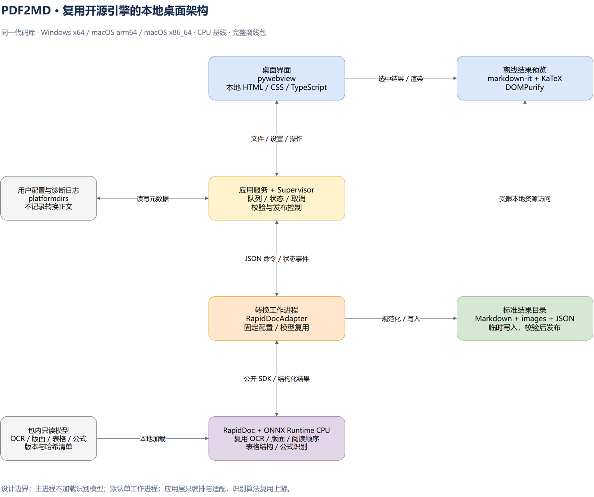

# PDF2MD 技术设计文档

## 1. 文档依据与技术结论

| 项目 | 内容 |
| --- | --- |
| 文档版本 | v0.4（应用 0.2.1 启动扩展） |
| 调研日期 | 2026-10-21，Asia/Shanghai |
| 需求依据 | [REQUIREMENTS.md](REQUIREMENTS.md)，v0.4；核对功能见第 15 节，启动优化见第 16 节 |
| 输入范围 | 各类 PDF，包含文本、扫描、混合、表格、多栏及数学公式 |
| 发布目标 | Windows x64、macOS arm64、macOS x86_64，同一代码库，分别构建 |
| 设计状态 | Windows 源码、真实转换、界面与原生窗口已验证；模型已下载；macOS 原生构建及完整质量基准仍待验证 |

首版实现采用 **CPython 3.11 + RapidDoc + ONNX Runtime CPU + pywebview + 本地 Markdown/KaTeX 预览 + PyInstaller**。直接复用完整文档解析流水线，由本项目实现界面、任务调度、引擎适配、结果校验及便携分发。

RapidDoc 已接入首版，MinerU 保留为效果对照及替换候选。首版只随包交付通过验收的一套解析引擎及模型，控制依赖重复。方案不要求自行实现 OCR、表格结构识别、公式识别或阅读顺序模型。

本文将“上游已有能力”“本项目设计选择”“仍需验证”分开说明。候选版本有安装包、声明支持某个平台，不等于本产品已通过该平台的离线运行验收。

## 2. GitHub 组件选型

### 2.1 建议采用的组件

| 职责 | 复用项目 | 选择与版本策略 | 本项目需要做的适配 |
| --- | --- | --- | --- |
| PDF 完整解析 | [RapidAI/RapidDoc](https://github.com/RapidAI/RapidDoc) | 以 `v0.9.11` 固定源码作为验证基线；通过测试后冻结提交及包哈希 | 输入限制、配置、页码映射、结果规范化 |
| CPU 推理 | [microsoft/onnxruntime](https://github.com/microsoft/onnxruntime) | 优先验证 `1.23.2`，覆盖三个目标平台；验证模型兼容后锁定 | 固定 CPU provider、线程与资源上限 |
| OCR | [RapidAI/RapidOCR](https://github.com/RapidAI/RapidOCR) | 由 RapidDoc 集成，遵守其 `>=3.4.0,<=3.10.0` 约束，再精确锁版 | 显式指定本地模型及字典，不再平行实现 OCR 流程 |
| PDF 元数据、页面及裁图 | [pypdfium2-team/pypdfium2](https://github.com/pypdfium2-team/pypdfium2) | 与 RapidDoc 共用一个发行版本，满足 `>=5.10.1,<6` | 页数、加密校验、页面选择及失败区域截图 |
| 桌面窗口、文件对话框及桥接 | [r0x0r/pywebview](https://github.com/r0x0r/pywebview) | `6.2.1` 为验证基线 | Python 服务接口、拖入文件、平台打开行为 |
| Markdown 渲染 | [markdown-it/markdown-it](https://github.com/markdown-it/markdown-it) | 核对时仓库版本为 `15.0.3`，与公式插件一起做兼容验证并锁版 | 预览、链接和本地资源映射 |
| Markdown 数学语法 | [goessner/markdown-it-texmath](https://github.com/goessner/markdown-it-texmath) | `1.0.0`（npm 实际发布版本），已验证与所选 markdown-it、KaTeX 的组合 | 使用现有美元分隔符解析，不自行编写公式正则解析器 |
| 数学排版 | [KaTeX/KaTeX](https://github.com/KaTeX/KaTeX) | `0.19.0` 为验证基线，JS/CSS/字体全部本地化 | 公式预览、HTML 表格单元格中的数学内容 |
| 预览 HTML 清理 | [cure53/DOMPurify](https://github.com/cure53/DOMPurify) | `3.4.17` 为调研版本，构建时核对修复情况并锁版 | 表格标签及资源地址白名单 |
| 简单表格 HTML → Markdown | [matthewwithanm/python-markdownify](https://github.com/matthewwithanm/python-markdownify) | 使用成熟转换库，具体版本进入 Python 锁文件 | 只转换能无损表达的简单表格 |
| 配置目录 | [tox-dev/platformdirs](https://github.com/tox-dev/platformdirs) | 锁定稳定版本 | Windows/Mac 配置、缓存和日志目录 |
| 数据结构校验 | [pydantic/pydantic](https://github.com/pydantic/pydantic) | 与上游 `>=2.12.5,<3` 约束一致，避免重复版本 | 设置、IPC 消息、报告及结构化内容校验 |
| 发布目录互斥 | [tox-dev/filelock](https://github.com/tox-dev/filelock) | 锁定稳定版本 | 多个实例发布时分配不冲突的结果目录 |
| 子进程清理与资源观测 | [giampaolo/psutil](https://github.com/giampaolo/psutil) | 锁定稳定版本 | 取消时清理本任务进程树，记录峰值内存 |
| 可运行包 | [pyinstaller/pyinstaller](https://github.com/pyinstaller/pyinstaller) | `6.22.3` 为验证基线，采用目录模式 | hooks、资源收集、平台签名及 ZIP 分发 |

其中 OCR、布局、公式、表格模型及其调用由 RapidDoc 已有流水线负责。不要再将 PaddleOCR、RapidOCR、RapidTable 等重新拼成另一套应用内解析框架。[固定版本依赖声明](https://github.com/RapidAI/RapidDoc/blob/v0.9.11/pyproject.toml)、[固定版本能力说明](https://github.com/RapidAI/RapidDoc/blob/v0.9.11/README.md)

前端使用轻量 HTML/CSS/TypeScript 和标准构建工具产出静态资源，不引入完整浏览器外壳或后台 WebUI。最终用户无需 Node.js；开发构建工具不进入运行包。是否需要 UI 组件库在界面原型阶段按实际交互决定。

### 2.2 解析引擎对比与取舍

| 候选 | 已有能力与证据 | 对本项目的主要影响 | 结论 |
| --- | --- | --- | --- |
| RapidDoc | 基于 MinerU 二次开发；集成 OCR、版面、阅读顺序、表格与公式；默认 Pipeline 支持 ONNX Runtime | 更接近小型 CPU 本地包目标；`0.9.11` 刚发布，Mac 构建和回归必须先验证 | 主引擎候选 |
| [MinerU](https://github.com/opendatalab/MinerU) | 完整解析及结构化输出；调研时 GitHub 正式版为 `4.0.12` | 当前依赖包含 Gradio、VLM 工具及 llama.cpp，Apple Silicon 默认依赖还引入 Torch；仅选择 Basic 不等于安装包已自动精简 | 效果对照，主方案不达标时验证替换 |
| [Docling](https://github.com/docling-project/docling) | 成熟的结构化文档转换项目，支持本地 PDF、表格及 OCR 体系 | 主要模型路径依赖 PyTorch，Intel Mac 要使用兼容的旧 Torch 组合；需要另做公式能力和包体积验证 | 保留备选，不进入首版默认包 |
| [Marker](https://github.com/datalab-to/marker) | PDF → Markdown/JSON，具有复杂内容处理路径 | 当前模型路径与运行依赖较多，代码和模型权重的许可需分别核对 | 不作为默认方案 |
| 单独使用 PDF 文本提取库 | 文本和 PDF 操作接口成熟 | 无法独立满足 OCR、复杂表格、公式及阅读顺序要求 | 仅作为元数据或辅助工具 |

比较依据：[RapidDoc 发布记录](https://github.com/RapidAI/RapidDoc/releases)、[MinerU 4.0.12](https://github.com/opendatalab/MinerU/releases/tag/mineru-4.0.12-released)、[MinerU 固定版本依赖](https://github.com/opendatalab/MinerU/blob/mineru-4.0.12-released/pyproject.toml)、[Docling 安装说明](https://github.com/docling-project/docling/blob/main/docs/getting_started/installation.md)、[Marker 项目说明](https://github.com/datalab-to/marker#commercial-usage)。上述选择是本项目针对功能、复用成本和体积的判断，不采用不同环境下的上游性能榜单作为本产品实测结果。

## 3. 跨平台兼容性的已知事实

### 3.1 ONNX Runtime 版本不能直接使用不受限的 latest

调研时 PyPI 最新 ONNX Runtime 为 `1.31.0`，其 CPython 3.11 macOS 安装包仅有 arm64；`1.23.2` 同时存在 Windows x64、macOS arm64 与 macOS x86_64 的 CPython 3.11 wheel。因此先验证三平台共用 `1.23.2`，再确认各模型的 ONNX opset、IR 版本及实际推理结果。[1.31.0 文件列表](https://pypi.org/project/onnxruntime/1.31.0/#files)、[1.23.2 文件列表](https://pypi.org/project/onnxruntime/1.23.2/#files)

如果必须使用不同版本，保持相同应用代码与模型语义，按平台生成独立锁文件，并完成同一验收集。不能让 Intel Mac 自动失去 OCR、表格或公式能力。

### 3.2 RapidDoc 需要由开发端构建 Mac 包

调研时 `rapid-doc==0.9.11` 的 PyPI wheel 仅包含 Windows 和 Linux x64。其构建脚本会按平台筛选随包 CUDA 原生库，Darwin 不包含这些 `.dll/.so`。Mac 方案需要在对应 Mac 架构上从固定版本源码构建并验证 CPU 发行包，不能要求最终用户自行编译。[发行文件](https://pypi.org/project/rapid-doc/0.9.11/#files)、[固定版本构建脚本](https://github.com/RapidAI/RapidDoc/blob/v0.9.11/setup.py)

首版使用 CPU ONNX 路径，显式关闭 CUDA 专用算子，禁止因环境探测而自动选择 Torch、OpenVINO 或 CUDA。是否在 Mac 完整通过仍是验证项，不能由上面的源码分支推断为已经通过。

### 3.3 桌面 WebView 的系统差异

- macOS 使用系统 WKWebView，窗口和业务代码保持共用。
- Windows 使用 pywebview 的 EdgeChromium 后端；完整包随附 Fixed Version WebView2 Runtime，通过 `WEBVIEW2_RUNTIME_PATH` 指定。
- 不能假设每台 Windows 都已安装 WebView2，也不能用首启下载来满足离线解压即用。
- 按选定 pywebview 版本检查 Windows 的 .NET Framework 前提，并在支持的系统版本上验证；Mac 同时核对 PyObjC 及本地二进制依赖。

依据：[pywebview 6.2.1 Web 引擎说明](https://github.com/r0x0r/pywebview/blob/6.2.1/docs/guide/web_engine.md)、[运行时路径实现](https://github.com/r0x0r/pywebview/blob/6.2.1/webview/platforms/edgechromium.py)、[Microsoft 分发说明](https://learn.microsoft.com/en-us/microsoft-edge/webview2/concepts/distribution)。Windows 的完整包体积包含 WebView2，Mac 使用系统 WebKit，因此两个平台的完整包大小不必相同。

## 4. 应用架构与复用边界



可编辑源文件：[architecture.drawio](docs/architecture.drawio)；矢量版本：[architecture.svg](docs/architecture.svg)。图中结果处理表示文件与格式适配，不代表另建识别算法。

| 模块 | 职责 | 优先复用 |
| --- | --- | --- |
| DesktopShell | 窗口、文件选择、拖入、剪贴板、打开结果、关闭确认 | pywebview、系统接口 |
| ApplicationService | 导入检查、设置快照、任务状态、批次汇总 | Python 标准库、Pydantic |
| WorkerSupervisor | 单工作进程、命令及事件通信、取消、异常恢复 | multiprocessing、psutil |
| RapidDocAdapter | 上游配置、本地模型、页码及结果适配 | RapidDoc 公开接口，少量固定版本封装 |
| ResultWriter | 资源重命名、JSON 校验、简单表格输出、最终发布 | pathlib、hashlib、filelock、markdownify |
| PreviewService | 预览分块及本地资源访问 | pywebview 桥接、markdown-it、KaTeX、DOMPurify |
| PackageBuilder | 离线依赖、模型清单、平台构建、签名和压缩 | PyInstaller，必要时 Mac 使用 py2app |

主进程不导入识别模型。0.2.1 在首屏后恢复基础状态，再让既有转换进程后台预热模型并保留实例；命令行仍在首次转换请求同步准备。异常或实际转换取消后回收进程并恢复资源准备状态。

允许本项目编写业务适配和平台代码。识别模型、解码器、表格匹配、公式识别及阅读顺序算法继续调用上游；需要修复上游时，固定补丁并记录来源，优先向上游提交，避免长期维护大型分叉。

## 5. RapidDoc 接入设计

### 5.1 使用公开 Python 接口

固定版本公开 `RapidDoc` 与 `RapidDocOutput`。后者包含 `markdown`、`images`、`middle_json`、`content_list_json`；调用支持 `parse_method`、页码范围、公式及表格开关、图片输出和调试输出开关。[公开接口源码](https://github.com/RapidAI/RapidDoc/blob/v0.9.11/rapid_doc/main.py)

以下是接入形态示意，`profile` 由本项目的本地模型配置生成；不是已经执行通过的示例：

```python
# 工作进程在导入引擎前设置 CPU 与本地资源位置。
os.environ["MINERU_DEVICE_MODE"] = "cpu"
os.environ["RAPID_MODELS_DIR"] = str(model_root)

from rapid_doc import RapidDoc

engine = RapidDoc(
    layout_config=profile.layout_config,
    ocr_config=profile.ocr_config,
    formula_config=profile.formula_config,
    table_config=profile.table_config,
    parse_method="auto",
    formula_enable=True,
    table_enable=True,
    pdf_pages_batch=8,
)

result = engine(
    pdf_path,
    start_page_id=0,
    end_page_id=4,
    f_dump_middle_json=False,
    f_dump_content_list=False,
    f_draw_layout_bbox=False,
    f_draw_span_bbox=False,
)
```

在该固定版本中，上例页码参数表示第 1–5 页，结束下标包含在范围内。程序不能将需求中的 1 基页码直接传入 0 基引擎。[页码截取实现](https://github.com/RapidAI/RapidDoc/blob/v0.9.11/rapid_doc/cli/common.py)

禁止把用户 PDF 路径拼成 shell 命令。优先在工作进程直接调用 Python API，不通过解析 CLI 终端文本获取转换结果。

### 5.2 默认模型组合

| 能力 | 初始验证配置 | 原则 |
| --- | --- | --- |
| 版面及阅读顺序 | PP-DocLayoutV3 的 ONNX 模型 | 优先验证上游已有顺序恢复，保留跨栏内容 |
| 正文 OCR | 上游集成的 PP-OCRv6-small 检测、识别及匹配字典 | 显式配置本地路径，中英文共同验证 |
| 公式 | PP-FormulaNet_plus-M ONNX | 先用默认中等模型验证质量，再比较 S 的体积收益 |
| 表格 | 上游有线/无线分类、UNET 与 SLANet_plus 组合 | 复用既有 HTML、合并单元格及续表处理 |
| 页面方向 | 上游方向模型及处理接口 | 验证 90°/180°/270°，默认关闭的能力需按需求启用 |

选择依据：[RapidDoc 固定版说明](https://github.com/RapidAI/RapidDoc/blob/v0.9.11/README.md)、[OCR 路径与默认配置](https://github.com/RapidAI/RapidDoc/blob/v0.9.11/rapid_doc/model/ocr/rapid_ocr.py)、[公式配置](https://github.com/RapidAI/RapidDoc/blob/v0.9.11/rapid_doc/model/formula/rapid_formula_model.py)。上述组合已保存到本地 `models/` 并通过实际转换验证：12 项资源合计 809,504,980 字节，来源、大小和 SHA-256 在 `models/manifest.json`；上游许可归属、第三方说明及发行目录许可收集方式见 `THIRD_PARTY_NOTICES.md` 和第 15 节。

不要直接照搬上游 `docvortex_mode="rule"` 的快速示例替换全部版面识别。该模式官方说明存在复杂版式精度取舍；默认保留模型版面分析，纯文本加速作为独立配置验证，不能跳过公式和扫描区域。

### 5.3 本地模型与离线配置

- 构建阶段下载模型及字典，来源固定到上游配置对应的版本或资源哈希；不要在用户首次运行时下载。
- `RAPID_MODELS_DIR` 作为部分模块的基础目录；OCR 源码还存在包内默认资源路径，因此必须逐项指定检测、识别、字典、布局、公式和表格的实际本地路径，不能只设置一个环境变量就声称完整离线。
- 统一选择 ONNX Runtime CPU，并显式关闭 CUDA 专用 `onnx_ops`，避免打入仅 Windows/Linux 的 CUDA 二进制。[算子路径实现](https://github.com/RapidAI/RapidDoc/blob/v0.9.11/rapid_doc/model/ocr/onnx_ops_session.py)
- 构建清单记录资源 ID、模型版本、来源、相对路径、大小、SHA-256 和许可证；同一文件只保留一份。
- 应用读取已验证清单，缺失或不匹配时在模型初始化前失败；不能让引擎回退到下载或另一套未交付模型。
- 完整包在没有模型缓存、没有开发环境的系统首次断网执行，并核查没有隐式网络请求；只设置某个下载器的离线变量不足以覆盖上游所有下载路径。

### 5.4 页码、分栏及内容完整性

1. 解析用户页码范围为升序去重的原文页号。
2. 将非连续选择拆成连续区间，例如 `1-3,5,8-9` 拆为三个区间；不在用户跳过的页面之间执行跨页段落或续表合并。
3. 每个区间使用同一个已预热引擎处理，记录局部页号 → 原文物理页号映射。
4. 使用上游阅读顺序及内容块，保持标题、跨栏图表和公式关联；不要把结果按文字坐标重新逐行排序。
5. 规范化并按区间顺序合并，恢复原文页号，统一资源命名，输出连续 Markdown。

页眉页脚清理沿用引擎能力，但核对默认忽略标签，区分重复页脚和有语义的脚注。保留正文脚注、参考文献及公式编号，不能因默认过滤配置而静默丢失。

上游部分页面导入代码存在“导入失败后跳过”的行为。本项目必须在调用前检查选中页，并在调用后核对页面覆盖与映射；无法证明完整、存在未知缺页时整份任务失败，不能发布看似成功的缺页结果。已确认空白的页面保留空白记录，与导入失败区分。[相关页面导入代码](https://github.com/RapidAI/RapidDoc/blob/v0.9.11/rapid_doc/cli/common.py)

### 5.5 公开接口的适配缺口

| 缺口 | 处理方案 |
| --- | --- |
| `RapidDoc.__call__` 没有公开的逐页进度及取消回调参数 | UI 先显示真实阶段和不确定进度；精确页级进度通过固定版本的薄封装或小补丁，在实际阶段/批次完成处发事件。该项需在 P0 实现，不虚构百分比 |
| SDK 会在内存中累计输出图片 | `pdf_pages_batch=8` 仅限制推理窗口，不保证总结果内存恒定；实测图片密集样本并及时写盘/释放；若超出预算，验证文件 writer 扩展，避免重写整个解析流程 |
| 统一告警、置信度和缺失原因不是稳定公共契约 | 适配已存在的模型/中间结果信息；未知置信度用空值，不编造分数；记录信息不足并验证是否需要小范围上游扩展 |
| 较新版本的方向、行内公式及跨页表格效果未在本地验证 | 作为第一阶段样本测试项目，不能用“库声明支持”代替通过验收 |

薄封装必须限于事件、资源路径、文件写入和数据字段映射。新增进度回调不改识别算法；补丁与版本锁一起管理，并设置对应契约测试。

## 6. 任务调度、通信与取消

### 6.1 进程设计

- 主进程运行 pywebview 和应用服务，后台线程读取文件元数据及进程事件。
- 使用 `multiprocessing` 的 `spawn` 模式，入口正确调用 `freeze_support()`；同一时间最多一个转换工作进程处理一个 PDF。
- 普通任务之间复用模型；任务设置为不可变快照，禁止 UI 修改运行任务配置。
- 使用 `multiprocessing.Connection.send_bytes/recv_bytes` 传递 UTF-8 JSON，Pydantic 校验版本、类型和长度；避免业务代码直接反序列化任意 pickle 对象。
- 大图片、全文中间结果和模型不通过 IPC 往返复制，写入任务目录后仅传递路径、摘要及状态。
- 日志与协议分离。每条事件带 `task_id`、工作进程代号、单调递增序号及时间，忽略已取消任务或旧工作进程的迟到事件。

建议协议类型包括 `run`、`cancel`、`shutdown` 及 `ready`、`phase`、`progress`、`warning`、`completed`、`failed`。长调用期间的取消主要由 Supervisor 执行，不能要求工作进程必须先读到 `cancel` 才能终止。

### 6.2 状态管理

使用一处任务状态机：`draft → queued → running → succeeded / succeeded_with_warnings / failed / cancelled`。应用 0.2.0 在核对完成后增加 `succeeded_reviewed`，与 `succeeded_with_warnings` 双向切换，见第 16 节。界面映射为需求中的中文状态；重试生成新的执行记录。

桥接调用和工作进程事件统一进入串行调度器处理状态变化；后台 I/O 返回结果事件，不直接修改任务。避免并发桥接线程、取消操作及完成事件同时写入状态。

`completed` 事件只表示工作结果已准备好；主进程核对输出并成功发布后，才把任务标记成功。批次汇总由状态数据计算，避免 GUI 自行累计导致取消、重试后数量错误。

### 6.3 取消与恢复

1. 点击取消后立即更新界面，并设置任务取消标记。
2. 已到可中断边界时协作退出；引擎仍在阻塞时，终止该工作进程及已记录的子进程，限时等待，必要时强制结束。
3. 取消后不发布临时结果；清理只处理当前任务创建并登记的目录。
4. “取消当前”完成后重新创建工作进程，继续队列；“取消全部”将等待项同时设为已取消。
5. 主进程退出时清理工作进程。进程归属以 PID 和创建时间核对，不能按进程名批量结束其他程序。

取消阈值沿用需求：普通可中断阶段目标 3 秒，阻塞阶段最长 10 秒。文件最终发布与取消状态检查在同一状态转换中串行处理，避免取消后迟到结果被发布。

## 7. 输出与数据契约

### 7.1 标准结果模型

应用维护独立的 `DocumentResult`，不把上游的 `middle_json` 原样作为长期公共格式：

| 字段 | 约定 |
| --- | --- |
| `schema_version` | 本工具格式版本，例如 `1.0` |
| `source` | 源文件名、总页数、选中物理页号；默认不记录绝对源路径 |
| `pages` | 来源页号、页尺寸、方向及页面处理结果，包括空白页 |
| `blocks` | 最终阅读顺序数组，包含稳定块 ID、类型、来源页号、区域和内容 |
| `spans` | 必要时记录段内文本及行内公式，避免把段内公式重复成独立块 |
| `resources` | 图片 ID、相对路径、来源位置、用途和哈希 |
| `warnings` | 代码、页号、块 ID、原因、回退形式；无可靠置信度时不填数值 |
| `producer` | 工具、引擎、模型、平台及配置标识 |

区域统一到“经方向校正的显示页面，左上为原点，归一化 `[x0,y0,x1,y1]`”，并保留必要的原页变换关系。禁止将 PDF 点单位、栅格像素和归一化数值混用。跨页表格使用多个来源区域，不伪造一个跨越多页的框。

### 7.2 Markdown、表格和公式

- 优先复用引擎生成的 Markdown 与内容列表，适配段落、页号、资源链接及报告。
- 有合并单元格、复杂表头或单元格内部结构的表格保持 HTML，保留 `rowspan/colspan`；使用现有 HTML 解析库检查结构。
- 仅对能无损表达的简单表格调用 markdownify 转为 GFM；缺少表头时按需求生成中性的列名，不把数据行误当表头。
- 统一 HTML 输出模式直接保留表格 HTML，不做无意义的双向格式转换。
- 行内与独立公式分别使用 `$...$`、`$$...$$`。保留编号、段内位置及表格内数学内容，调用 KaTeX 检查支持的语法；可渲染不代表数学内容正确，仍需对照样本。
- 正常正文图片受图片开关控制；失败回退图单独标记用途，保留对应位置的警告。
- 资源重命名通过结构化引用映射执行，同时更新 Markdown、HTML 和 JSON；不能全局字符串替换而误改正文或 LaTeX。

### 7.3 输出目录与发布

```text
output/
└── 项目报告/
    ├── 项目报告.md
    ├── content_list.json
    ├── conversion-report.json
    └── images/
```

任务先写入同一输出磁盘的专用临时目录，便于最终重命名发布。发布前检查页面覆盖、必要文件、资源引用、UTF-8、JSON 格式及告警统计。

使用短时间文件锁保护最终目录名分配与发布；已有目录采用 `_2` 等后缀。失败、取消及磁盘写入错误只清理临时结果，保留源 PDF 与已发布目录。所有输出文件句柄在发布前关闭，兼容 Windows 文件占用规则。

`content_list.json` 含转换正文；`conversion-report.json` 与诊断日志仅记录元数据和警告，不复制正文或图片内容。失败任务可导出不含正文的任务报告。

## 8. 图形界面与离线预览

### 8.1 桌面桥接

界面通过 `window.pywebview.api` 调用少量明确的服务：选择文件/目录、导入任务、获取任务快照、开始、取消、读取预览、复制及打开结果。不要暴露通用 Python 执行或任意路径读写接口。

文件拖入复用 pywebview 的 DOM 事件支持，在 Python 侧取得完整路径。事件字段按锁定版本封装并测试，不从浏览器的 `File.name` 猜测完整路径。[pywebview 6.2.1 API](https://github.com/r0x0r/pywebview/blob/6.2.1/docs/api/README.md)

UI 通过轻量事件或定期增量快照更新；只在状态变化时刷新相关行。转换与目录检查不在 UI 主线程执行，长文档预览分块加载。

### 8.2 Markdown 与数学预览流程

1. 获取本地 Markdown 或按内容块切分的预览片段，避免在公式/表格内部截断。
2. markdown-it 配合 markdown-it-texmath 处理正文与数学语法，避免 Markdown 先破坏 LaTeX 中的转义和下划线。
3. DOMPurify 清理生成的 HTML，允许必要表格、MathML 和 KaTeX 排版结构，限制不需要的链接及标签。
4. 对原始 HTML 表格中的数学文本使用 KaTeX 的 auto-render 扩展；不要假定 Markdown 数学插件会解析原始 HTML 单元格。
5. 使用本地 CSS/字体完成展示；数学错误转为可读提示，不能让一条公式阻断全文。

KaTeX 关闭不受信任扩展，并限制宏展开；不执行文档中的脚本。公式插件、DOM 清理和 HTML 表格公式组合列为单独兼容测试。[texmath 用法](https://github.com/goessner/markdown-it-texmath)、[KaTeX](https://github.com/KaTeX/KaTeX)、[DOMPurify](https://github.com/cure53/DOMPurify)

本地资源由受限预览服务映射到选定结果目录：复用 pywebview 本地服务能力，只增加必要的任务资源路由，绑定回环地址。路径解析限制在允许的资源根目录，禁止把整个磁盘作为静态目录。外部图片不自动加载，外部链接经应用交给系统浏览器，页面导航不能把带桥接能力的主窗口转到远程网站。

## 9. 便携打包与体积控制

### 9.1 发布形式

| 目标 | 完整包 | 构建与执行要求 |
| --- | --- | --- |
| Windows x64 | ZIP，内含 `.exe`、共享运行库、WebView2、模型及静态资源 | 在 Windows x64 构建，解压双击；无需安装运行环境 |
| macOS arm64 | ZIP，内含 `.app`、模型及资源 | 在 arm64 Mac 构建并签名、公证，使用系统 WKWebView |
| macOS x86_64 | ZIP，内含 `.app`、Intel 依赖、模型及资源 | 在 Intel 兼容构建环境验证，不能只在 Apple Silicon 上启动后宣布通过 |

采用 PyInstaller `onedir`，将运行库和模型分层存放；避免大模型嵌入 `onefile` 后每次启动重新解包。PyInstaller 按目标平台构建，不能在 Windows 生成可运行 Mac 包。使用少量平台 spec 和 hook，应用源代码保持共用。[PyInstaller](https://github.com/pyinstaller/pyinstaller)、[目录模式说明](https://pyinstaller.org/en/stable/usage.html)

pywebview 官方冻结说明对 Mac 推荐 py2app，因此 Mac 的 PyInstaller/WKWebView/PyObjC 组合先做启动、桥接、拖入与预览验证；若失败，Mac 切换 py2app 打包，业务代码不变。[pywebview 冻结说明](https://github.com/r0x0r/pywebview/blob/6.2.1/docs/guide/freezing.md)

### 9.2 依赖与模型锁定

- 每个平台保存精确依赖锁文件和下载哈希；Python 首先统一为 3.11 系列，补丁版本在构建验证后固定。
- RapidDoc 固定 tag 及解析后的提交；保存 Mac 自建 wheel 的构建记录、源码哈希和产物哈希。
- 开发阶段可正常解析完整依赖；发布阶段根据 import 分析与测试裁剪，不能直接对上游使用 `--no-deps` 后宣称依赖已满足。
- 保留动态导入需要的模块、包元数据、字典和二进制库。仅安装包版本查询就可能依赖 `.dist-info`，不能盲目删除。
- Windows、Mac 的构建环境各自干净，避免 pywebview 顺带收集无关 Qt/CEF 组件。
- 模型与程序在同一完整包交付；以后可提供保留模型的程序更新包，但标明前置版本，不能冒充完整包。
- 生产版本默认不包含 CUDA、Torch、OpenVINO、VLM、Gradio、Office 转换器和调试资源；其中任何被间接导入的模块，需先验证可安全排除再裁剪。

### 9.3 体积如何度量

分开报告主程序、Python/桌面桥接、推理运行时、PDF/图像库、WebView2、模型、静态资源的解压大小，以及最终 ZIP 大小、首次启动时间和峰值内存。

当前没有本地完整包数据，不承诺一个未经验证的 MB 数字。以满足全部 P0 的最小完整包为第一阶段产物，再固定三平台体积预算；引擎 wheel 文件大小不能作为包含全部依赖和模型后的应用大小。

优先通过去除重复运行时、精确收集模块、按架构分包、模型资源去重及保留单一引擎减小体积。更小模型或量化仅在 OCR、表格、公式和阅读顺序回归通过后采用。

### 9.4 配置与应用资源位置

程序资源相对于应用包解析，模型只读加载。配置、日志、WebView 缓存和任务临时数据使用 platformdirs 对应的用户目录。macOS 不修改签名后的 `.app` 内容；移动应用或结果目录后仍能运行和预览。

macOS 对内嵌动态库、工作入口和应用逐层签名并公证，ZIP 保留可执行权限。Windows 完整包核查 WebView2 再分发要求及系统前提。模型、源代码和第三方运行时分别登记许可，不能仅依据仓库首页的单个许可证标记判断整个包。

RapidDoc 源码声明 Apache-2.0；MinerU `4.0.12` 使用附加条款，不能只登记成普通 Apache-2.0；Marker 的代码与模型权重条款也不同。替换引擎时重新核对其固定版本及模型清单。[RapidDoc LICENSE](https://github.com/RapidAI/RapidDoc/blob/v0.9.11/LICENSE)、[MinerU LICENSE](https://github.com/opendatalab/MinerU/blob/mineru-4.0.12-released/LICENSE.md)、[Marker 项目说明](https://github.com/datalab-to/marker#commercial-usage)

## 10. 建议代码目录

以下为开发时的计划结构，当前仅交付设计文档及架构图：

```text
pdf2md/
├── REQUIREMENTS.md
├── TECHNICAL_DESIGN.md
├── pyproject.toml
├── locks/                    # 三个平台的精确依赖锁定
├── src/pdf2md/
│   ├── entry.py              # 主程序与冻结进程入口
│   ├── desktop/              # pywebview、对话框、平台操作
│   ├── application/          # 任务、队列、设置与状态机
│   ├── worker/               # spawn、IPC、取消与恢复
│   ├── engines/              # Engine 协议及 RapidDoc 适配
│   ├── output/               # 规范化、资源、报告、发布
│   ├── preview/              # 分块预览及受限资源映射
│   └── resources/            # 应用配置模板
├── frontend/                 # 静态界面源码与资源锁定
├── models/                   # 构建下载产物，不默认提交大模型
├── packaging/                # spec、hooks、签名与清单生成
├── tests/
│   ├── contract/             # 固定引擎与输出协议
│   ├── integration/          # 转换、取消、页码与资源
│   └── packaging/            # 离线首次启动及平台验收
└── docs/
    ├── architecture.drawio
    └── architecture.svg
```

`Engine` 协议至少包含配置检查、模型预热、转换、资源释放及能力描述。先实现一个 RapidDocAdapter，保留替换入口；不提前实现多个重复引擎和自动降级链。

## 11. 验证顺序与验收映射

### 11.1 第一阶段先验证整条链路

| 步骤 | 实际产物 | 通过条件 |
| --- | --- | --- |
| 1. 依赖解析 | 三平台锁文件、wheel 清单、Mac 自建 RapidDoc wheel | CPython 3.11 + 选定 ORT 可导入全部必需模块，无意外 GPU/服务依赖 |
| 2. 单文档解析 | 数学教材和英文论文的选定页面结果 | Markdown、HTML 表格、LaTeX、阅读顺序达到参考要求 |
| 3. 补齐样本 | 清晰扫描、混合、三栏、旋转、表格和公式基准 | 不用纯文本样本替代 OCR 与复杂内容验收 |
| 4. 离线模型 | 完整模型清单及首次断网结果 | 空缓存仍可处理全部 P0；缺模型明确失败 |
| 5. 最小桌面包 | Windows 与两种 Mac 架构包 | 对话框、拖入、桥接、图片、HTML 表格和公式预览可用 |
| 6. 资源与取消 | 耗时、峰值内存、包大小、取消记录 | 可取消阻塞推理；图片密集样本无不可接受内存增长 |
| 7. 选型冻结 | 版本、模型、体积及性能预算 | 通过后再完整实现业务界面及发布流程 |

RapidDoc `0.9.11` 的发布时间接近本次调研，不能仅因它最新就跳过回归。若该版本不达标，可在相同适配协议下评估此前发行或 MinerU；每次替换重新验证依赖及模型，不同时捆绑多个引擎掩盖问题。

### 11.2 需求覆盖

| 需求/验收项 | 技术对应 |
| --- | --- |
| FR-01/02，AC-01/06 | PDFium 校验、任务状态机、独立任务错误与重试 |
| FR-03/04，AC-02/03 | 设置快照、连续区间、页号映射、正文质量验证 |
| FR-05，AC-04 | RapidDoc 表格流水线、HTML/GFM 适配、图片资源校验 |
| FR-06，AC-08/09/15 | Supervisor、实际阶段事件、进程取消与异常恢复 |
| FR-07，AC-12/20 | pywebview、本地 Markdown/KaTeX 渲染、移动后预览 |
| FR-08，AC-10/13/21 | 页面覆盖校验、错误映射、模型与结果报告 |
| FR-09，AC-07/11/18/19 | 三平台完整包、首次离线、发布锁和体积明细 |
| FR-10，AC-05 | 本地 OCR、混合区域去重、旋转与扫描样本 |
| FR-11，AC-16 | 上游阅读顺序、跨栏关联、顺序 Markdown |
| FR-14，AC-17 | 上游公式模型、行内位置与编号、LaTeX 及人工核对 |
| NFR 性能，AC-14 | 各平台冷启动/预热基准、内存与包大小记录 |

沿用需求中的正文 98%、清晰印刷扫描 OCR 95% 等目标。表格结构、公式内容及阅读顺序独立核对，截图回退单独统计，不能折算为识别成功。

### 11.3 测试工具与边界

Python 使用 pytest 测契约与任务流程；预览渲染使用成熟前端测试工具；Windows/Mac 实机核对原生文件对话框、拖入、首次打开和打包后的桥接。浏览器页面测试不能替代实际 WKWebView/WebView2 的集成验证。

优先测试有实际风险的边界：非连续页码、上游跳页、表格内数学、重复资源命名、输出不可写、取消与发布竞争、缺模型、异常进程、旧事件及首次离线启动。少量固定样本做持续回归，完整质量集用于引擎和模型变更。

## 12. 首版技术决策记录

| 决策 | 采用方式 | 理由 |
| --- | --- | --- |
| 完整解析 | 先验证并复用 RapidDoc | 已有 MinerU 衍生流水线及 ONNX 路径，减少重新组合算法工作 |
| CPU 基线 | 三平台优先统一 ORT 1.23.2 | 存在三架构安装包，兼容性以实际模型回归决定 |
| 图形界面 | pywebview + 本地静态资源 | 共用 Python 与网页界面，复用系统 WebView |
| Windows 离线 | 包内 Fixed Version WebView2 | 满足没有系统 WebView2 的首次离线使用 |
| 预览格式 | Markdown + GFM/HTML + LaTeX | 对应复杂表格和公式表达要求，复用成熟渲染库 |
| 运行隔离 | 一个可回收工作进程 | 界面响应、模型复用、阻塞调用取消与故障恢复 |
| 分发方式 | 目录模式冻结后按架构 ZIP | 减少重复解包，完整包含运行时与必需模型 |
| 体积承诺 | 先交最小完整包及明细，再固定预算 | 模型实测约 772 MiB；Windows 完整目录约 1.7 GiB，压缩包约 1 GiB，含固定 WebView2 |

实现与验证结果见第 15 节及 `docs/verification.md`。流程测试通过不等于全部文档类型的质量基准通过，macOS 尚未实机验收。


## 15. 首版实现与实测记录（2026-10-21）

实现使用 CPython 3.11.17、RapidDoc 0.9.11、RapidOCR 3.10.0、ONNX Runtime 1.23.2、pypdfium2 5.10.1、pywebview 6.2.1；Windows 完整依赖见 `requirements-windows.lock`，前端依赖见 `package-lock.json`。新增轻度倾斜校正直接复用 [jdeskew 0.4.2](https://github.com/phamquiluan/jdeskew)，只依赖已有 NumPy 与 OpenCV，不引入 SciPy 或另一套 OCR。

### 15.1 代码组织

- `src/pdf2md/domain.py`：设置、任务及输入边界；`service.py`：批次、工作进程、取消、原子发布与预览。
- `engine.py`：固定版本 RapidDoc 适配、本地路径、扫描方向/倾斜预处理、页码/资源规范化；`quality.py`：上游 OCR 置信证据、公式基本语法与续表提示。
- `worker.py`：可终止的独立推理进程；`models.py`：清单与 SHA-256；`output.py`：简单表格转换、资源引用、发布互斥及临时目录清理。
- `desktop.py`：pywebview 原生窗口、对话框、拖放、系统打开及 loopback 静态资源/API 服务。
- `frontend/`：原生 HTML 表单、TypeScript、Markdown/KaTeX/DOMPurify；`src/pdf2md/web/` 为随包静态资源，包含字体。
- `scripts/download_models.py`、`download_webview.py`、`build_portable.py` 和 `packaging/PDF2MD.spec`：可重复准备和原生构建。`.github/workflows/build.yml` 提供手动触发的 Windows / 两种 Mac 架构构建配置，尚未运行远程构建。

### 15.2 模型与适配结论

`models/manifest.json` 已物化 12 项资源，合计 **809,504,980 字节**。布局使用 PP-DocLayoutV3；公式使用 PP-FormulaNet Plus M；OCR 使用 PP-OCRv6 small 检测、识别及字典；表格使用 UNET、SLANet Plus 与两种分类器；方向使用 RapidOrientation。附带上游资源中的印章检测与 Magika 文件分类器。转换时 OCR、版面、公式及表格模型显式使用本地路径；表格方向辅助模块从同一权重复制到包内固定兼容路径，工作进程禁止外网连接，首次完整哈希校验失败即报错。

实际接入发现 RapidOrientation 返回 `(方向标签, 耗时)`，第二项不是置信度；适配层没有将其作为质量分数。扫描页支持 90/180/270 度校正；轻度倾斜通过 jdeskew 全页和主体区域一致性检查后校正，保留校正记录。文本丰富的原生页面不栅格化。

上游 API 不提供取消及进度回调。保留其公开转换 API，只对固定版本的批次阶段与中间结果生成方法加观测封装，发送真实阶段、已完成页数和实际 native/OCR 模式；取消时结束工作进程，后续任务新建进程。升级 RapidDoc 时必须重跑集成测试。CPU 原生算子优化关闭，无 Torch/CUDA/OpenVINO 依赖。

跨页表格合并复用 RapidDoc 已有逻辑；上游未合并而空间及列结构疑似续表时保留分段和页码警告，不自行猜测拼接。公式使用 pylatexenc 做基本语法检查，失败保留区域图片；不能以语法检查推断数学内容正确。OCR 警告只使用上游实际保留的分数，缺失时记录空值。

### 15.3 分发与验证边界

Windows 使用 onedir，权重位于 EXE 同级 `models/`；完整包携带微软官方 Fixed WebView2，轻量分发可复用系统运行时。主进程桥接对象仅公开操作方法，原生窗口和内部服务使用私有属性，避免 pywebview 递归枚举原生对象。

Mac 的 RapidDoc 0.9.11 没有 PyPI wheel，因此依赖声明固定使用该 tag 对应源码提交 `0c446b6f074068e88331ffee575187e17cb4ac6d`，由上游 setup.py 排除不适用的 DLL/SO。同一个 spec 原生生成 `.app`，使用系统 WKWebView，模型放入应用 Resources；归档使用 `ditto` 保留框架符号链接。这个构建路径尚未在 Mac 上执行，不宣称已通过兼容性验证。

已验证用户提供的双栏英文论文、3 个表格的文字/扫描版本、数学教材扫描页、旋转页、2° 倾斜页、混合 PDF 的非连续选页和关闭正文图片。后端单元及真实集成测试、浏览器真实转换与无障碍检查均有记录。尚未完成 300 页压力测试、全类型公式/复杂表格质量基准及 Mac 实机验收。完整记录见 [docs/verification.md](docs/verification.md)。

## 16. 应用 0.2.0：对照核对工作区（2026-10-22）

本节为用户确认的核对能力补充设计，替代前文仅预览、队列临时保存的初版约定。复用现有转换模型、PDFium、Markdown/KaTeX 和内容净化，新增编辑依赖使用成熟的 [CodeMirror 6](https://github.com/codemirror/dev)。实际验证结果与未完成项统一记录在 `docs/verification.md`，设计要求不等于验收通过。

### 16.1 定位数据与 PDF 显示

- PDF 使用 pypdfium2 按需渲染原始页，前端 SVG 叠加归一化原文多边形。同进程 PDFium 调用串行，不在多个线程同时访问 PDFium；见 [官方线程说明](https://pypdfium2.readthedocs.io/en/stable/python_api.html#thread-incompatibility)。
- 扫描预处理记录原始页到纠偏页的精确矩阵，包含 90/180/270 度旋转、倾斜修正和扩展画布偏移；识别坐标经逆变换映射回原 PDF，保存多边形而非假设仍为轴对齐矩形。
- 固定版本 RapidDoc 在跨页段落和表格合并前记录稳定来源。合并后沿用其内容和阅读顺序，合并块保留多个原始区域。
- 在最终 Markdown 块生成流程记录文本范围；资源重命名、表格格式适配及公式/表格截图回退均同步更新映射，不用全文查找匹配重复内容。
- `content_list.json` 新增提示稳定 `id`、`block_ids`、`source_regions` 和 `markdown_ranges`，块本身也保留范围。所有文本偏移是 UTF-16 code unit，范围为 `[start,end)`；前端编辑器、预览 token 与后端变更验证统一这一约定。
- 精确来源不存在时仅定位物理页，页面或关联块层级必须在 UI 明示。旧结果不补造精确范围；原 PDF 发生变化时停用几何定位。

### 16.2 核对服务接口

本地桥和 loopback API 提供相同方法，参数仍由注册任务限定文件边界：

| 接口 | 输入与结果 |
| --- | --- |
| `review_document(task_id)` | 读取完整 Markdown、SHA-256、核对版本、所有警告和块范围、页面信息、源文件状态、待核对/已核对数量 |
| `review_page(task_id,page,scale)` | 物理页码从 1 开始，返回按需渲染的原始 PDF 页资源及显示尺寸；拒绝越界或不可读来源 |
| `save_review(task_id,payload)` | 完整正文、预期指纹和版本、相对上次正文的 UTF-16 变更、逐项核对更新；成功返回完整核对文档 |
| `open_review_result()` | 原生文件选择器打开已有结果，注册为本地任务；服务层路径入口为 `open_review_result_path(md_path,source_path='')` |
| `locate_review_source(task_id)` | 原生选择原 PDF 并校验指纹；服务层为 `locate_review_source_path(task_id,path)` |

核对文档最小结果包含 `ok,markdown,sha256,review_revision,warnings,blocks,pages,source,notice,reviewed_count,pending_count`；警告带 `reviewed`，不改变其原始问题类型和消息。保存请求：

```json
{
  "markdown": "完整正文",
  "expected_sha256": "当前已读取正文的SHA-256",
  "expected_revision": "读取时返回的核对修订标识",
  "changes": [{"from": 0, "to": 2, "insert": "替换内容"}],
  "review_updates": {"稳定提示ID": true}
}
```

变更集相对同一份上次读取的正文，区间不能越界、重叠或切断 UTF-16 代理对；应用结果必须等于提交正文。仅允许已存在的提示 ID。服务完整读取正文，普通预览的截断或分页响应不能用于保存。HTTP 请求和桥接均须允许至少 32 MiB UTF-8 正文，同时限制渲染尺寸和非法页码；不放宽任意文件读取入口。

### 16.3 一致性、持久化与恢复

- 保存时先比较磁盘正文 SHA-256 与核对版本，冲突返回明确 `conflict` 且不覆盖；前端保留草稿，可复制或重新载入。无法可靠追踪外部编辑时重新载入并清空已核对标记，说明原因。
- 通过编辑变更映射所有块范围；受影响块关联的已核对提示恢复待核对，再应用本次明确提交的标记。同一块多个提示同时恢复，其他块保留原核对状态。
- Markdown 和 `review-state.json` 均采用同目录临时文件与原子替换。核对状态含正文指纹、修订号、当前范围和逐项状态；原始警告仍在转换内容与报告中。
- 首次正文修改前保留同目录 `文件名.original.md`，只创建一次，后续编辑不覆盖原始转换结果备份。
- 两个文件不能作为单个文件系统原子事务：先成功写正文，再写核对状态，只有持久化成功才更新任务完成状态；状态写入失败返回 `markdown_saved:true` 和磁盘正文指纹，前端明确区别。重新打开时指纹不一致则恢复为待核对，避免虚报已核对。
- 最后一条提示保存后状态为 `succeeded_reviewed`、中文「完成 · 已核对」；撤销或修改相关内容恢复 `succeeded_with_warnings`。无警告任务继续使用 `succeeded`。导出任务报告包含 `reviewed_count/pending_count` 汇总与保留的警告，不写入 Markdown 正文。原始 `conversion-report.json` 不因人工核对重写；随结果移植的核对状态以 `review-state.json` 为唯一权威，避免引入三文件一致性事务。
- 与设置同级持久化任务索引，重启恢复路径及状态。启动时将此前运行/排队任务转为中断状态，禁止虚报进度。移除列表只删除索引条目，不删除 PDF 或转换结果。
- 源文件路径缺失仍允许编辑 Markdown，提供原生重新关联。源 PDF 的指纹变化时暂停页区域高亮；重新关联必须确认是原文。已有结果可通过 Markdown 路径和邻接结构化文件注册，旧格式可靠降级。

### 16.4 界面行为与验证

三栏核对桌面保留转换界面的纸张视觉与语义颜色。问题列表拥有独立滚动、筛选和前后导航；PDF 翻页缩放；编辑器与渲染预览共享块定位。窄屏使用可折叠问题列表和上下文档布局。所有异步页图、文档加载和保存忽略已过期响应。

未保存正文在离开、切换任务和关闭时使用应用内对话框处理；Ctrl/Cmd+S 与按钮调用同一保存操作。保存期间固定操作尺寸，禁止重复提交；失败保持正文、当前问题和编辑器焦点。状态同时使用文字与图标，原文高亮也有问题编号和页码可读描述。

后端核对测试使用合成 PDF 和文件，不加载识别模型，覆盖 UTF-16、同块关联、指纹/版本冲突、任务恢复、旧格式、大正文和两阶段写入失败；转换回归另测旋转、倾斜、非连续页和跨页来源。浏览器测试验证编辑/核对/撤销/全部完成/未保存保护、中文输入、窄屏、键盘及无障碍。Windows 0.2.0 便携包需执行解压运行复验；macOS 同源构建与实机验收仍分别记录。


## 17. 应用 0.2.1：先绘制与后台准备

静态服务与原生窗口使用轻量 DeferredService；首次双 animation frame 后调用 initialize，再在后台导入 ApplicationService。BeautifulSoup/markdownify 与文件锁在实际转换或保存入口导入。ApplicationService(deferred=True) 不读取任务、核对文件或模型清单；默认同步模式供 CLI 和程序调用使用。

基础恢复先读取验证局部 Settings/Task/核对状态，持锁一次提交。startup 的 pending/loading/ready/failed 状态加入快照；所有状态变化更新 revision。只有 ready 才允许修改任务和持久化索引。关闭标记先于恢复提交，避免初始空列表或晚到恢复覆盖磁盘。

warmup 使用同一工作进程和 Pipe。每个完整预热/转换交换独占 io_lock；消息带 request_id 与进程 generation，旧回复被过滤。预热调用 RapidDoc.warmup，补齐 BatchAnalyze 的 lang=None aggregate 及方向识别 atom 缓存，与转换共用配置与实例，不创建虚拟文档。remove_headers/formula 构成配置标识，设置改变时只补实际缺失缓存。queued 任务等待匹配资源，失败保持队列并等待 retry_warmup。重试重建进程，实际转换取消使已就绪状态失效。

前端主入口为 ESM，esbuild splitting 生成独立 Markdown 与 CodeMirror/review chunks。构建时将主工作区 CSS 内联到 HTML，减少首屏阻塞请求，仍保留 app.css 供预览 iframe 使用。初始化 pending/loading 期间以 100 ms 刷新，ready/failed 后恢复 650 ms；initialize 返回时立即刷新，并合并重入请求。模块 Promise 共享，首屏后后台预取。统一 loading 管理前台活动与后台 startup/warmup，并用请求归属防止过期请求清除当前状态；失败资源提供重试入口。原有核对版本、原子保存、源文件校验及原生异步关闭路径保持原行为。

新增兼容接口 initialize()、retry_warmup()；snapshot 新增 startup 与 warmup 字段。其他接口签名不变。详细流程与测量边界见 docs/startup.md，验收记录见 docs/verification.md。
